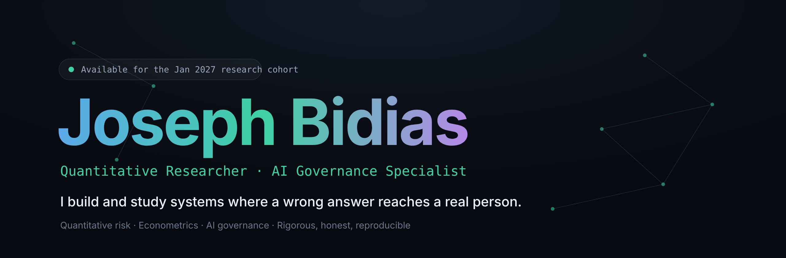

 

**I build and study systems where a wrong answer reaches a real person.**
Quantitative risk, econometrics, and AI governance. Rigorous methods, honest reporting, and results you can reproduce.

---

## Flagships — working software

Not demos. Real systems you can clone, run, and read.

<table>
<tr>
<td width="50%" valign="top">

### QuantRisk
*Fixed-income and credit-risk analytics platform*

A daily risk pipeline that turns a bond and credit portfolio into the numbers a risk desk acts on: valuations and key-rate durations, Value-at-Risk and Expected Shortfall, a named-scenario stress engine, and a credit PD model with macro stress. Roughly **4,800 lines of Python** with **37 passing tests**, an HTML report, and a live Streamlit dashboard. Runs on sample data, or real FRED Treasury curves when configured.

[**Live dashboard**](https://quantrisk-xck8k3qxmovw9fr7mgpbgn.streamlit.app/) · [**Code**](https://github.com/eaglepython/quantrisk) · [**Showcase**](https://quantrisk1.netlify.app/)

</td>
<td width="50%" valign="top">

### Regime-Aware Pairs Trader
*Master's capstone, Financial Engineering*

Does pausing a pairs trade during high-volatility regimes improve risk-adjusted performance? A Markov-Switching regime filter tested on the XLE/XOP energy ETF pair across the 2018 oil selloff and the COVID-19 crash, with cointegration tests, VaR backtests, and a stress analysis. I reported it straight: the pair was not cointegrated and neither strategy was profitable, but the filter cut the maximum drawdown and sat out the crash. **An honest null result.**

[**Repository and figures**](https://github.com/eaglepython/Regime-aware-pairs-trader)

</td>
</tr>
</table>

---

## How I work

| Rigorous methods | Honest reporting | Reproducible |
|---|---|---|
| Econometrics, statistical tests, and validation. I check whether the assumption holds before I trust the result. | I report results even when they are null or inconvenient. A clean negative finding beats a dressed-up one. | Tests, documentation, and code someone else can run. If it cannot be rerun, it is an anecdote, not a result. |

---

## Quantitative finance

| Project | What it is | |
|---|---|---|
| **Quant AI/ML Portfolio** | Econometrics, option pricing, ensemble signals, and related research. Backtested and educational. | [Repository](https://github.com/eaglepython/quant_ai_ml_portfolio) |

---

## AI governance and policy

Browser prototypes that explore practical problems in AI oversight. Each runs on sample or simulated data and is labeled that way on purpose. None is deployed in an agency or company.

| Project | What it explores | |
|---|---|---|
| **Healthcare LLM Governance Toolkit** | A weighted risk questionnaire for healthcare AI and a mock oversight dashboard | [Code](https://github.com/eaglepython/healthcare-llm-governance-toolkit) · [Demo](https://eaglepython.github.io/healthcare-llm-governance-toolkit) |
| **Multi-LLM Orchestration Platform** | Routing requests across providers to reduce single-vendor dependence | [Code](https://github.com/eaglepython/multi-llm-orchestration-platform) · [Demo](https://eaglepython.github.io/multi-llm-orchestration-platform/) |
| **AI Ethics Monitoring Dashboard** | Which bias and fairness measures an oversight team needs on one screen | [Code](https://github.com/eaglepython/ai-ethics-monitoring-dashboard) · [Demo](https://eaglepython.github.io/ai-ethics-monitoring-dashboard) |
| **Policy Analysis Dashboard** | Market concentration (HHI) and cost analysis from an uploaded CSV | [Code](https://github.com/eaglepython/policy-analysis-dashboard) |

---

## Toolkit

---

## About

I am a quantitative researcher and AI governance specialist. Over more than ten years I have put machine learning and risk systems into public health programs at Texas Health and Human Services, county services at Marin County, clinical research at the University of Florida, and production at Verizon and Apple. Across all of it, the hard question is rarely the model. It is who checks it, what gets measured, and what happens when a check fails.

**[the7thsenselab.vercel.app](https://the7thsenselab.vercel.app/)**  ·  **[github.com/eaglepython](https://github.com/eaglepython)**

Released under the MIT License. Prototypes run on sample or simulated data; nothing here is investment advice.

